<div align="center">

<picture>
  <source media="(prefers-color-scheme: dark)" srcset="demo/images/hero-banner-dark.svg">
  <source media="(prefers-color-scheme: light)" srcset="demo/images/hero-banner-light.svg">
  
</picture>

<br><br>

[**See It in Action**](#see-it-in-action) &nbsp;·&nbsp;
[**Install & Uninstall**](#install--uninstall) &nbsp;·&nbsp;
[**Under the Hood**](#under-the-hood) &nbsp;·&nbsp;
[**CI Setup**](#ci-setup) &nbsp;·&nbsp;
[**Allure TestOps**](#allure-testops) &nbsp;·&nbsp;
[**Contact Monty**](#lets-talk)

<br>

<a href="https://www.npmjs.com/package/allure-katalon-bridge"></a>
<a href="https://github.com/montbaga/allure-katalon-bridge/actions/workflows/ci.yml"></a>
<a href="LICENSE.md"></a>
<a href="https://github.com/montbaga/allure-katalon-bridge/commits/main"></a>
<a href="#lets-talk"></a>
<a href="https://github.com/sponsors/montbaga"></a>

</div>

<br>

> **The problem in one minute:** Katalon Studio has no first-party Allure adapter. DIY setups collide with Katalon's bundled Jackson dependencies, misplace `allure-results/` across IDE vs CLI runs, misname multi-suite Test Suite Collections, and force you to rewrite hundreds of test cases.
>
> **Allure-Katalon Bridge wires it in automatically.** One `npx` command (or double-clicking one OS installer) installs a lightweight Test Listener, shaded Allure jars, and auto-report generation — **no plugins, no OSGi packaging, zero edits to Test Cases or Test Suites**. Read [`ARCHITECTURE.md`](ARCHITECTURE.md) for the internals.

<br>

## See it in action

https://github.com/user-attachments/assets/f88a1e71-5e50-4e7b-b246-41c4d9b387e6

<br>

<table width="100%">
<tr>
<td width="33.3%" valign="top">
  <strong>1 · Zero-touch reporting</strong><br><br>
  Run any Suite, Collection, or Test Case as usual. Gets timing, failure screenshots, DOM/XML source, masked API requests, and history trends automatically.
</td>
<td width="33.3%" valign="top">
  <strong>2 · Single-file HTML ready</strong><br><br>
  Generates <code>allure-report/&lt;Name&gt;_&lt;timestamp&gt;.html</code> natively with Allure's <code>--single-file</code> mode — double-click to open with no web server needed.
</td>
<td width="33.3%" valign="top">
  <strong>3 · Built for CI &amp; TestOps</strong><br><br>
  Verified end-to-end on Windows, macOS, and Linux across GitHub Actions, Azure Pipelines, GitLab CI, and selective Allure TestOps test-plan reruns.
</td>
</tr>
</table>

<br>

<table>
  <tr>
    <td width="50%" valign="top">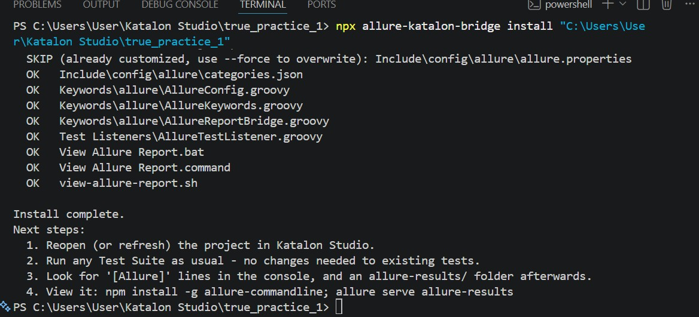<br><sub><b>1 · Install in one command:</b> Run <code>npx allure-katalon-bridge install</code> or double-click your OS installer.</sub></td>
    <td width="50%" valign="top">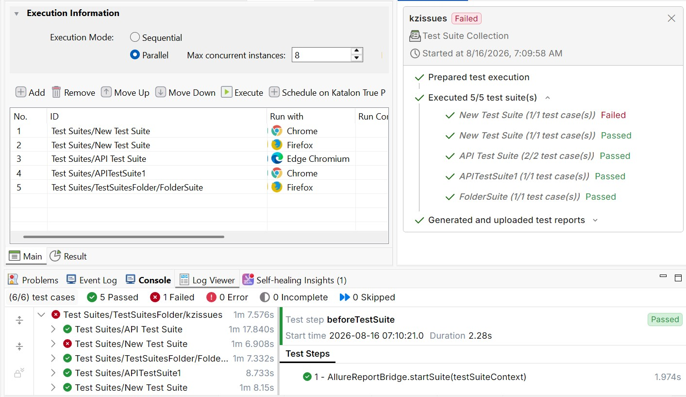<br><sub><b>2 · Run normally:</b> Execute any Test Suite or Collection inside Katalon Studio or CI without changing a line of test code.</sub></td>
  </tr>
  <tr>
    <td width="50%" valign="top">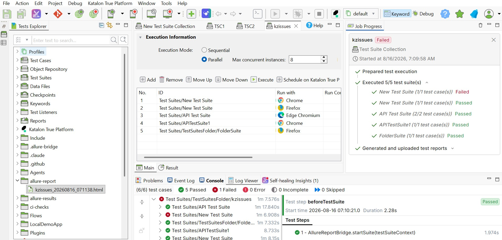<br><sub><b>3 · Generated automatically:</b> Self-contained <code>.html</code> report lands straight inside <code>allure-report/</code> with carried trend history.</sub></td>
    <td width="50%" valign="top">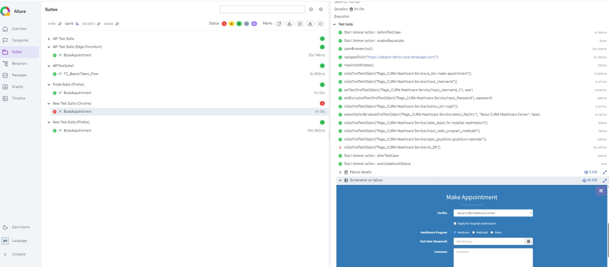<br><sub><b>4 · Open anywhere:</b> Suites, steps, failure screenshots, HTTP payloads, and history trends in one standalone file.</sub></td>
  </tr>
</table>

---

## Why this exists

<picture>
  <source media="(prefers-color-scheme: dark)" srcset="demo/images/five-pillars-dark.svg">
  <source media="(prefers-color-scheme: light)" srcset="demo/images/five-pillars-light.svg">
  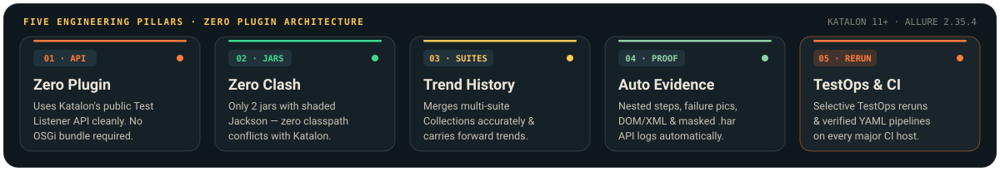
</picture>

<br>

| DIY / Plugin Obstacle | How Allure-Katalon Bridge Solves It |
| :--- | :--- |
| No first-party adapter or hook to drive Allure | Uses Katalon's public, documented Test Listener API (`@BeforeTestSuite`, `@BeforeTestCase`, `@AfterTestCase`, `@AfterTestSuite`) |
| Allure's transitive Jackson clashes with Katalon's Jackson | Ships only `allure-java-commons` + `allure-model` whose Jackson is shaded internally (`io.qameta.allure.internal.shadowed.*`) |
| Results scatter across working directories (IDE vs CLI vs CI) | Resolves `allure-results/` explicitly against the project root (`*.prj`), never process `cwd` |
| Reporting bugs risk failing or altering real tests | Every lifecycle hook catches its own exceptions and logs warnings only |
| Cannot afford to edit thousands of existing tests | Zero-touch at suite/case level; step keywords and tags are completely opt-in |

---

## Install & uninstall

Three ways to install — pick **npx** (same command on every OS), your **desktop double-click script**, or the **GitHub Action**:

<table width="100%">
<tr>
<td width="33.3%" valign="top">
  <strong>1 · npm / npx (Any OS)</strong><br><br>
  <code>npx allure-katalon-bridge install "/path/to/katalon/project"</code><br><br>
  Works identically on Windows, macOS, and Linux. Add <code>--force</code> to overwrite a customized <code>allure.properties</code>.
</td>
<td width="33.3%" valign="top">
  <strong>2 · Double-Click Installer</strong><br><br>
  • <strong>Windows:</strong> Double-click <code>Windows\Install.bat</code> (or drop your project folder onto it)<br>
  • <strong>macOS:</strong> Double-click <code>macOS\Install.command</code><br>
  • <strong>Linux:</strong> Run <code>./Linux/install.sh</code>
</td>
<td width="33.3%" valign="top">
  <strong>3 · GitHub Actions</strong><br><br>
  <code>uses: montbaga/allure-katalon-bridge@v1</code><br><br>
  Keeps CI checkouts synced automatically without needing Node script boilerplate.
</td>
</tr>
</table>

<details>
<summary><b>Full install &amp; uninstall commands per platform (CLI flags, PowerShell, Bash, global install)</b></summary>

#### npm (any OS)
```sh
npx allure-katalon-bridge install "/path/to/your/katalon/project"      # add --force to overwrite a customized allure.properties
npx allure-katalon-bridge uninstall "/path/to/your/katalon/project"    # add --remove-config to delete allure.properties/categories.json
```
To install globally once and reuse: `npm install -g allure-katalon-bridge`, then run `allure-katalon-bridge install ...`.

#### Windows (`Windows/`)
- **GUI / Drag-and-drop:** Double-click `Windows\Install.bat` (or drop the project folder onto `Install.bat` / `Uninstall.bat`).
- **Scripted / CI:**
```powershell
.\Windows\install.ps1 -ProjectPath "C:\path\to\your\katalon\project"      # add -Force to overwrite a customized allure.properties
.\Windows\uninstall.ps1 -ProjectPath "C:\path\to\your\katalon\project"    # add -RemoveConfig to delete config files
```

#### macOS (`macOS/`) & Linux (`Linux/`)
- **macOS Finder:** Double-click `macOS\Install.command` or `macOS\Uninstall.command`.
- **Scripted / CI (shared bash engine):**
```bash
./Linux/install.sh /path/to/your/katalon/project      # add --force to overwrite a customized allure.properties
./Linux/uninstall.sh /path/to/your/katalon/project    # add --remove-config to delete allure.properties/categories.json
```

> **Safe upgrades & clean uninstalls:** Re-running install upgrades files in place. Uninstall reads `<project>/.allure-bridge/manifest.txt` and removes only what the bridge installed, leaving `allure-results/` and customized `allure.properties` intact unless `--remove-config` is passed.

</details>

<details>
<summary><b>Requirements &amp; what the installer copies into your project</b></summary>

#### Requirements
- **Katalon Studio** (verified on `11.4.0` locally and `11.3.0` in CI; uses stable public APIs).
- **Windows, macOS, or Linux** (`allure-commandline` via `npm install -g allure-commandline` for **Allure 2** HTML report generation). *Note: Allure 3 (`npm install -g allure`) is not supported yet — the bridge warns clearly and still writes raw `allure-results/` JSON.*

#### What gets installed (and tracked in `.allure-bridge/manifest.txt`)
```text
Test Listeners/AllureTestListener.groovy      auto-discovered by Katalon — the only wiring needed
Keywords/allure/AllureReportBridge.groovy     engine: status mapping, attachments, environment/executor/categories files
Keywords/allure/AllureConfig.groovy           allure.properties reader with ALLURE_* env var overrides
Keywords/allure/AllureKeywords.groovy         optional step(), attach*, severity(), epic(), flaky(), issue(), tmsLink()
Include/config/allure/allure.properties       configuration (every key documented inside and below)
Include/config/allure/categories.json         failure categorization tuned to Katalon/Selenium exceptions
Drivers/allure-java-commons-2.35.4.jar        Apache-2.0, Qameta Software — the only 2 jars needed
Drivers/allure-model-2.35.4.jar
Drivers/fetch-allure-jars.ps1                 re-download & sha1-verify jars from Maven Central if repos disallow binaries
View Allure Report.bat / .command / .sh       optional helper to open the newest report (or serve multi-file mode)
```

*(By default `allure.report.single.file=true` writes a standalone single `.html` that opens straight from disk. Only multi-file reports with `allure.report.single.file=false` need `View Allure Report` / `allure open` to avoid browser `file://` CORS restrictions.)*

</details>

---

## Under the hood

<picture>
  <source media="(prefers-color-scheme: dark)" srcset="demo/images/lifecycle-flow-dark.svg">
  <source media="(prefers-color-scheme: light)" srcset="demo/images/lifecycle-flow-light.svg">
  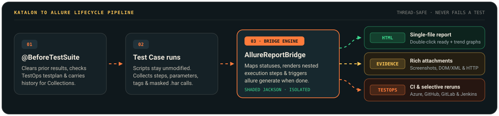
</picture>

<br>

- **Intelligent naming & Test Suite Collections:** A Test Suite Collection merges all member suites into **one report** named after the Collection itself (derived reliably from Katalon's report folder structure) and preserves history/trends across runs. Single Test Suites and ad-hoc Test Cases name after themselves.
- **Accurate test identity & retries:** Suites group as `Collection > Test Suite > Browser`, parameterizing `Browser` and `Execution profile` so Chrome and Firefox runs carry separate histories without colliding, while failed `@SetUp` / `@TearDown` hooks still surface as broken results instead of empty reports.
- **No-code Katalon metadata:** Test Case **Descriptions** map straight to Allure descriptions; **Variables** become parameters (masked variables stay `******`); and **Tags** support `allure.label.<name>:<value>`, `allure.flaky`, `allure.muted`, `allure.known`, `allure.issue:...`, and `allure.tms:...`.
- **Automatic forensic evidence:** Failed WebUI or Mobile test cases attach a screenshot plus HTML DOM / Mobile XML hierarchy automatically. API tests attach every `.har` request/response (`POST https://… -> 200`) with `Authorization`, cookies, passwords, tokens, and API keys scrubbed to `******`.

<details>
<summary><b>Opt-in Groovy keywords (nested steps, labels, JSON/file attachments)</b></summary>

```groovy
CustomKeywords.'allure.AllureKeywords.step'('Log in as admin', {
    WebUI.setText(findTestObject('Page/input_Username'), 'admin')
    WebUI.click(findTestObject('Page/button_Login'))
})
CustomKeywords.'allure.AllureKeywords.severity'('critical')
CustomKeywords.'allure.AllureKeywords.epic'('Patient Management')
CustomKeywords.'allure.AllureKeywords.attachJson'('Booking payload', responsePayload)
```

Also available: `attachText`, `attachHtml`, `attachFile`, `attachScreenshot`, `feature`, `story`, `label`, `link`, `issue`, `tmsLink`, `parameter`, `flaky`, `muted`, and `known`.

</details>

<details>
<summary><b>Configuration keys (<code>Include/config/allure/allure.properties</code> &amp; <code>ALLURE_*</code> overrides)</b></summary>

Every key can be overridden via environment variables (`ALLURE_<UPPER_SNAKE_CASE>`, e.g., `ALLURE_RESULTS_DIR`), including suites executed with **Enable Parallel Execution**.

| Key | Default | Meaning |
| :--- | :--- | :--- |
| `allure.enabled` | `true` | Master switch — `false` turns reporting off |
| `allure.results.dir` | `allure-results` | Raw Allure output directory (relative to project root or absolute) |
| `allure.clean.results.before.run` | `true` | Clears unrelated prior runs on suite start (preserves suites inside the same Collection) |
| `allure.auto.generate.report` | `true` | Runs `allure generate` (Allure 2) when the run finishes |
| `allure.report.dir` | `allure-report` | Generated HTML destination folder (`<Name>_<timestamp>`) |
| `allure.report.single.file` | `true` | Standalone `.html` (`false` creates a folder for massive suites) |
| `allure.commandline.path` | *(auto-detected)* | Explicit path to Allure 2 executable if needed |
| `allure.categories.file` | `Include/config/allure/categories.json` | Failure categorization rules |
| `allure.capture.steps` | `true` | Converts Katalon's own execution log into nested Allure steps + step failure screenshots |
| `allure.attach.screenshot.on.failure` | `true` | Screenshot on failed WebUI/Mobile tests (`attach.screenshot.always` for every test) |
| `allure.attach.page.source.on.failure` | `true` | Captures HTML DOM / Mobile view XML on failure |
| `allure.attach.http` | `true` | Attaches masked `.har` API request/response pairs |
| `allure.link.issue.pattern` / `tms.pattern` | *(none)* | URL template with `{}`, e.g., `https://jira.example.com/browse/{}` |
| `allure.parameters.excluded` | *(none)* | Comma-separated volatile variable names (`orderId,timestamp`) excluded from history ID |
| `allure.testplan.enabled` | `true` | Follows `ALLURE_TESTPLAN_PATH` / `allure.testplan.path` for selective TestOps reruns |

</details>

---

## Verified in CI across Windows, macOS & Linux

The same `kzissues` Test Suite Collection runs unmodified on Azure Pipelines hosted agents across all three operating systems (full config in [`azure-pipelines.example.yml`](azure-pipelines.example.yml)), auto-detecting `executor.json` metadata on **GitHub Actions**, **Azure Pipelines**, **GitLab CI**, and **Jenkins**.

<table>
  <tr>
    <td width="33.3%" valign="top">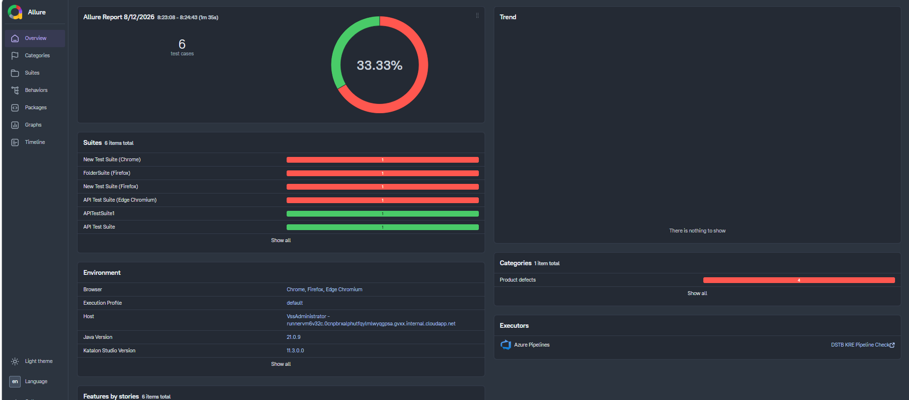<br><sub><b>Windows CI:</b> Report generated with full environment details.</sub></td>
    <td width="33.3%" valign="top">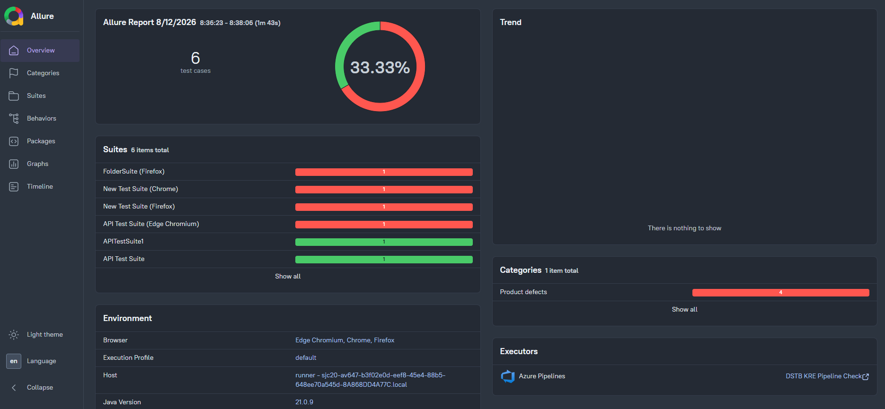<br><sub><b>macOS CI:</b> Identical pipeline &amp; embedded report artifacts.</sub></td>
    <td width="33.3%" valign="top">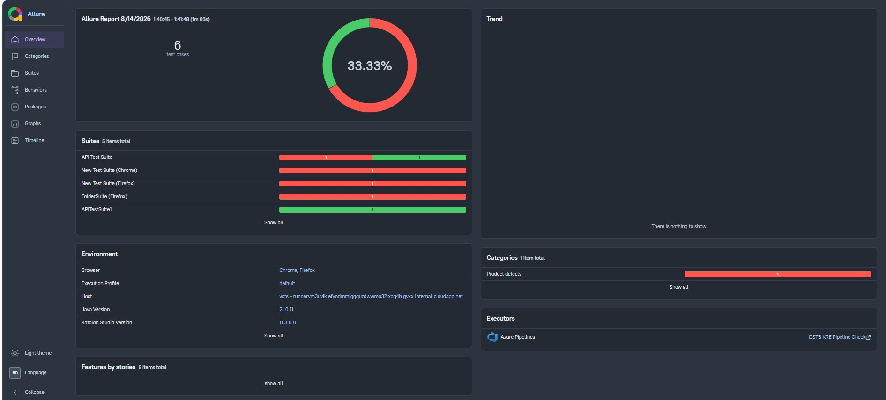<br><sub><b>Linux CI:</b> Cross-platform Chrome execution &amp; trends.</sub></td>
  </tr>
</table>

<details>
<summary><b>More CI pipeline &amp; artifact screenshots (Azure Pipelines Win/macOS/Linux runs)</b></summary>

<table>
  <tr>
    <td width="50%" valign="top">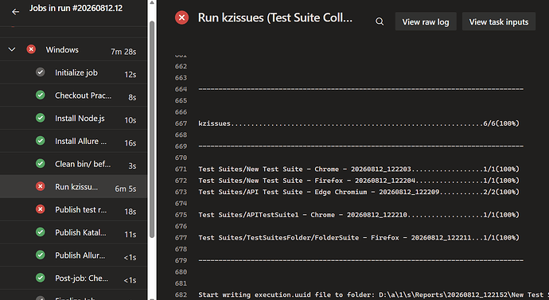<br><sub>Windows hosted agent run</sub></td>
    <td width="50%" valign="top">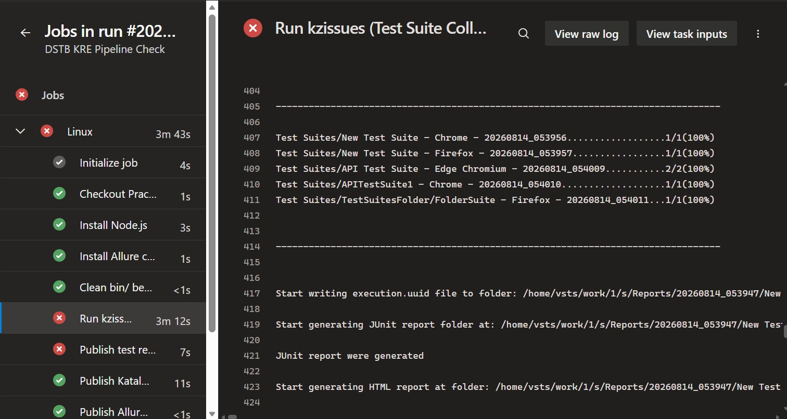<br><sub>Linux hosted agent run</sub></td>
  </tr>
  <tr>
    <td width="50%" valign="top">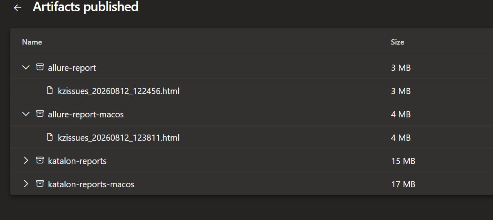<br><sub>Downloadable artifacts (Windows + macOS)</sub></td>
    <td width="50%" valign="top">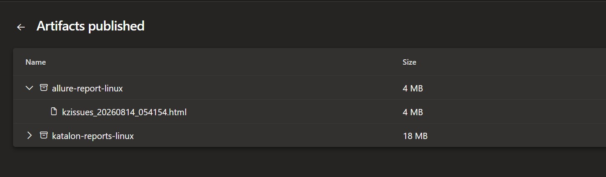<br><sub>Downloadable artifacts (Linux)</sub></td>
  </tr>
</table>

</details>

---

## CI setup

Four verified, copy-paste starter workflows live in this repo — [`github-actions.example.yml`](github-actions.example.yml), [`azure-pipelines.example.yml`](azure-pipelines.example.yml), [`gitlab-ci.example.yml`](gitlab-ci.example.yml), and [`testops-github-actions.example.yml`](testops-github-actions.example.yml).

```yaml
# Minimal GitHub Actions step using the published Marketplace Action
- uses: montbaga/allure-katalon-bridge@v1
  with:
    project-path: '${{ github.workspace }}'
```

<details>
<summary><b>Step-by-step setup guides (GitHub Actions, Azure Pipelines, GitLab CI, &amp; important CI gotchas)</b></summary>

### GitHub Actions
1. Copy [`github-actions.example.yml`](github-actions.example.yml) to `.github/workflows/katalon-ci.yml`.
2. Add your Katalon Runtime Engine key under **Settings → Secrets and variables → Actions** as `KATALON_API_KEY`.
3. Replace `<YourCollection>` in `args` with your Suite/Collection path, commit, and push. Artifacts land under the run's **Artifacts** panel.

### Azure Pipelines
1. Copy [`azure-pipelines.example.yml`](azure-pipelines.example.yml) to `azure-pipelines.yml`.
2. Install **"Execute Katalon Studio Tests"** from the Azure DevOps Marketplace.
3. Under **Pipelines → Library**, create variable group `Katalon` with secret `KatalonApiKey`.
4. Update `<YourCollection>` (or swap for `-testSuitePath`), commit, and push. Artifacts show up on the run's **Summary** tab.
5. *Multi-step note:* Clear `bin/` before each additional `katalonTask` step so `katalonTask` doesn't pick up a stray `*.prj` inside `bin/`.

### GitLab CI
1. Copy [`gitlab-ci.example.yml`](gitlab-ci.example.yml) to `.gitlab-ci.yml`.
2. Add masked CI/CD variable `KATALON_API_KEY`, update `<YourCollection>`, and push.
3. Note: uses `katalonstudio/katalon` Docker (Chrome), or target GitLab's `saas-windows-medium-amd64` runner for Edge/Windows parity.

### Important notes for all CI platforms
- **Self-updating CI:** All starter configs install/upgrade the bridge cleanly on CI without committing back to git; run the installer locally once so desktop Katalon Studio runs report too.
- **`--config -webui.autoUpdateDrivers=true`:** Kept in all examples so hosted agents fetch matching browser drivers automatically and avoid `SessionNotCreatedException` (the `--config` prefix is required by Katalon's parser).

</details>

---

## Allure TestOps

Send every CI run's results to [Allure TestOps](https://qameta.io/) and **rerun only selected tests** cleanly from TestOps: TestOps dispatches your workflow with `ALLURE_TESTPLAN_PATH`, and the bridge runs only matching cases (`Test Cases/...` selector or `allure.label.ALLURE_ID:<id>`) while skipping the rest.

<details>
<summary><b>Complete 4-step Allure TestOps + GitHub Actions walkthrough (with 11 setup screenshots)</b></summary>

### 1 · One-time Allure TestOps setup
1. **API Token:** Avatar → **API Tokens** → **+ Token** (paste into GitHub `ALLURE_TOKEN`).  
   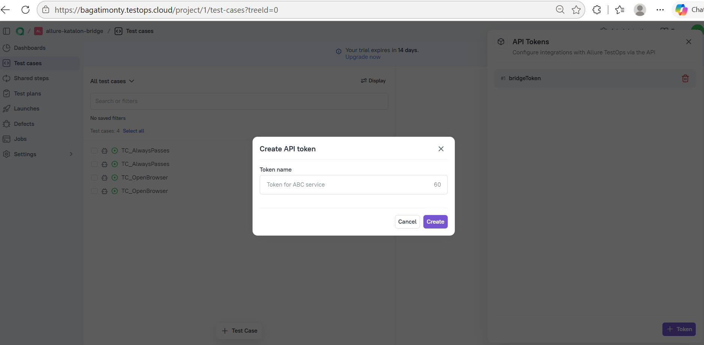
2. **GitHub Integration:** **Administration → Integrations → + Add integration → GitHub** (`github.com`, `https://github.com`, `https://api.github.com` → **Enable integration**).  
   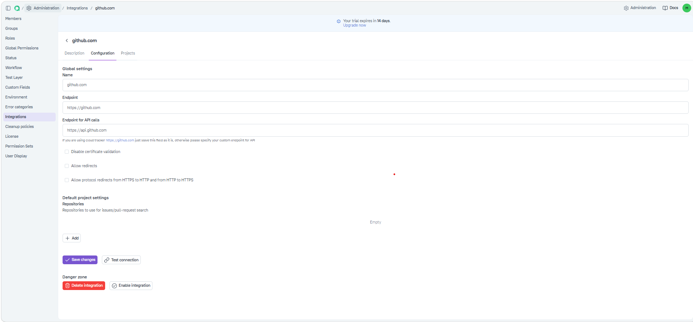
3. **Project Token:** **Settings → Integrations → github.com**, paste your GitHub PAT → **Test connection** → **Save changes**.  
   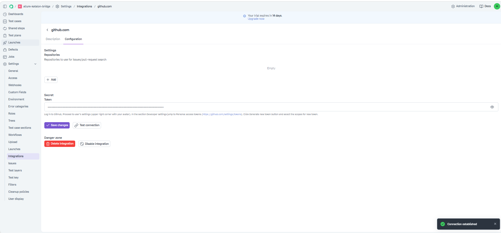

### 2 · GitHub repo configuration
1. Create a fine-grained PAT (`Actions: Read and write`) for TestOps step 1.3.
2. Add secrets `ALLURE_TOKEN` & `KATALON_API_KEY`, and variables `ALLURE_ENDPOINT` & `ALLURE_PROJECT_ID`.
3. Copy [`testops-github-actions.example.yml`](testops-github-actions.example.yml) to `.github/workflows/allure-testops.yml` **on your default branch**.

### 3 · First launch & job binding
1. Trigger **Actions → Allure TestOps → Run workflow**.  
   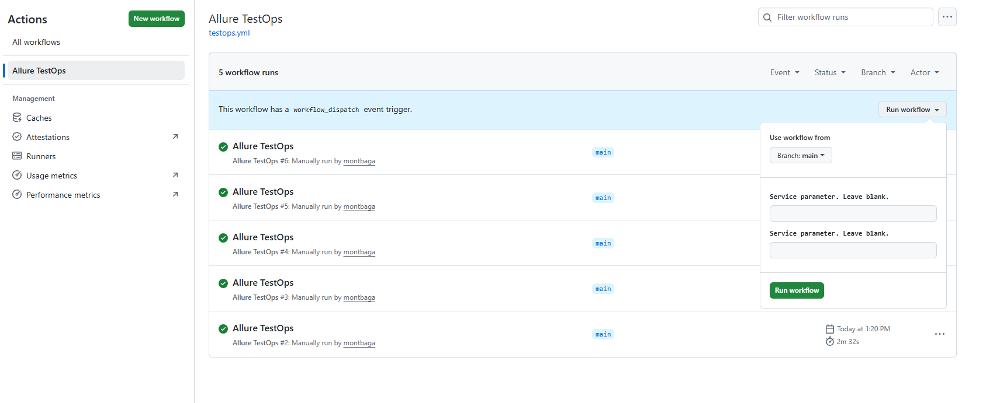  
   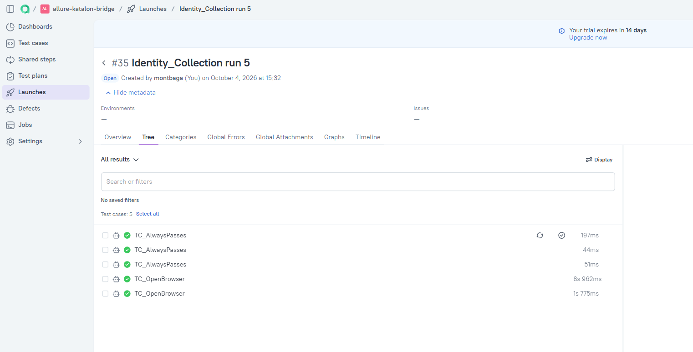
2. Under **Jobs → ⋯ → Configure**, bind `github.com`, enable **Job can be used to run tests**, add `Branch = main`, submit, and refresh (`⟳`).  
   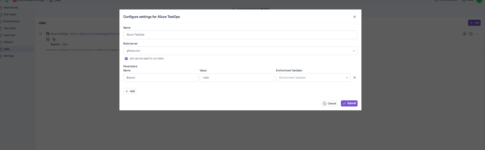  
   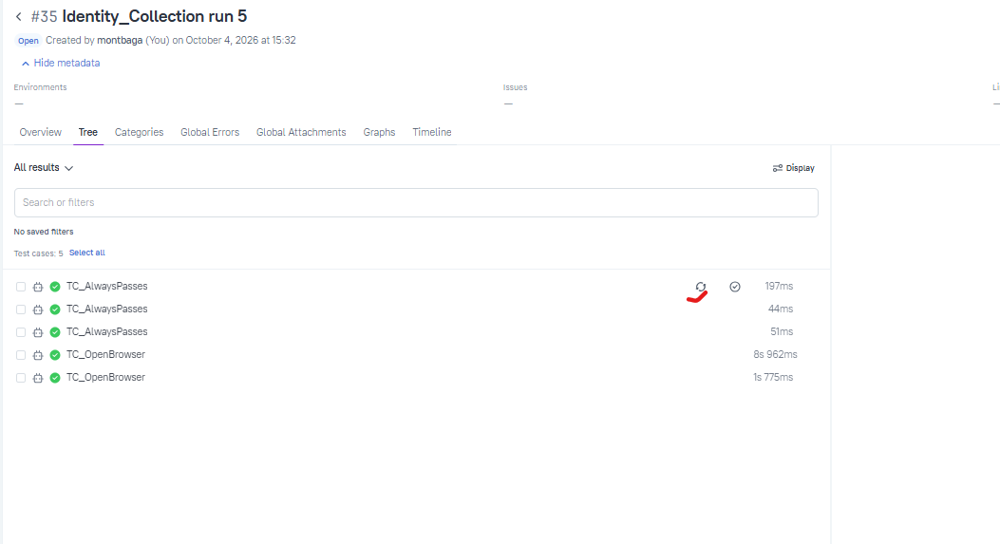

### 4 · Rerun selected tests cleanly
1. In a launch **Tree**, tick cases → **⋯** → **Rerun** *(avoid **Rerun manually**, which converts tests into manual tests)*.  
   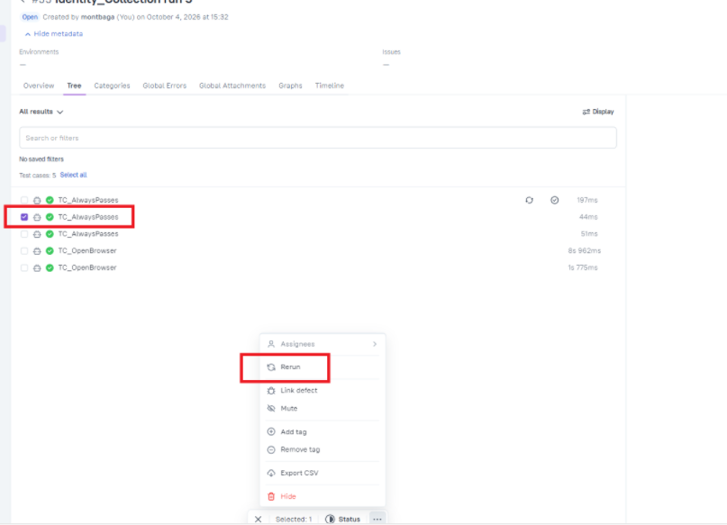  
   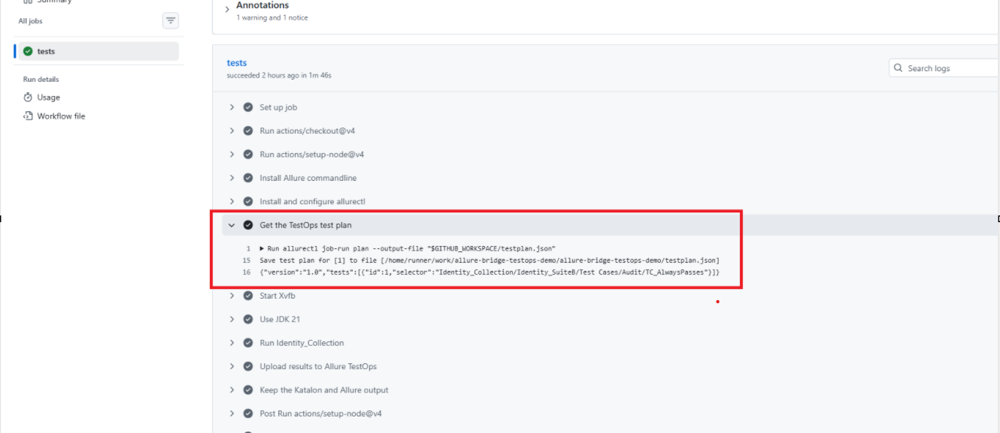  
   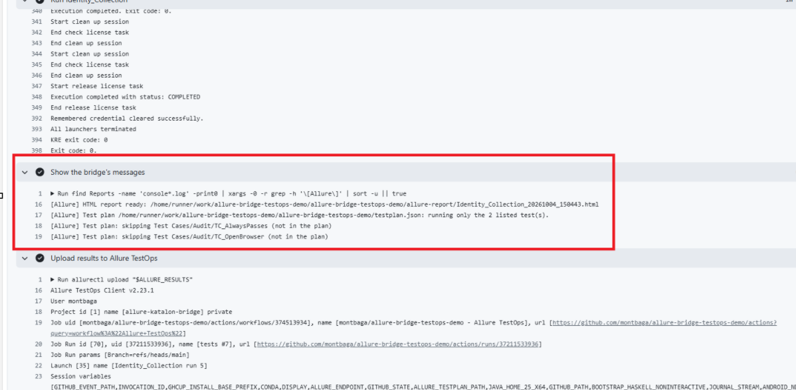  
   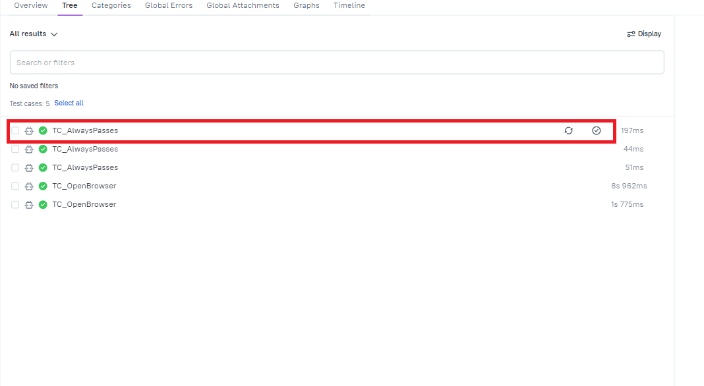
2. Set `allure.testplan.enabled=false` in `allure.properties` to ignore test plans and run everything unconditionally:  
   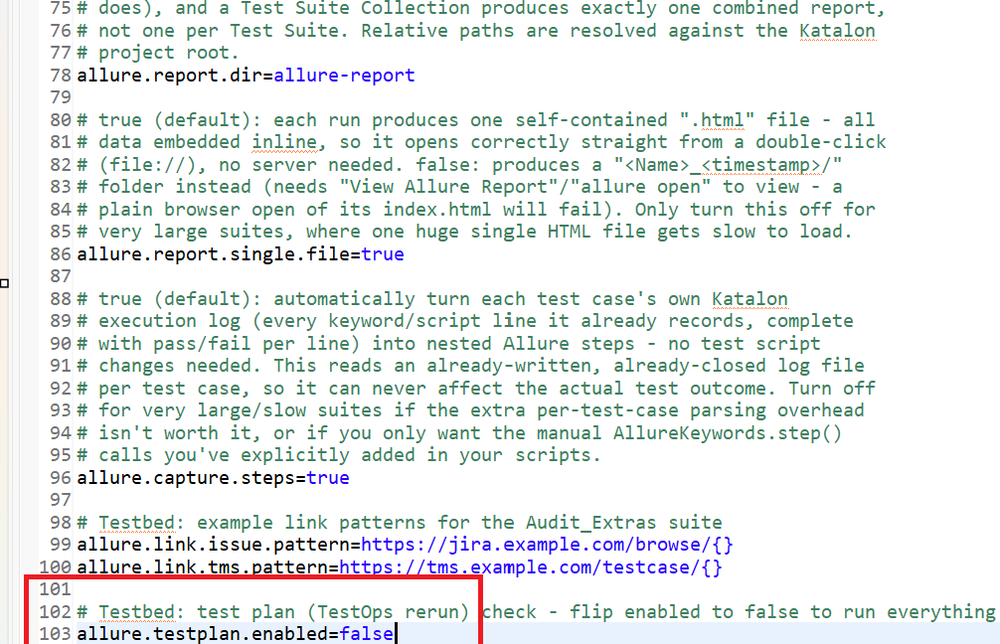

</details>

---

## Reference, troubleshooting & sponsors

<details>
<summary><b>Troubleshooting (logs, Allure 2 vs Allure 3, macOS/Linux GUI PATH, partial Collection runs)</b></summary>

- **Finding `[Allure]` logs:** Open Katalon's **Console** tab, or in CI grep `Reports/`:
  ```bash
  find Reports -name 'console*.log' -print0 | xargs -0 -r grep -h '\[Allure\]'
  ```
- **Allure 3.x warning:** `npm install -g allure` installs Allure 3. Install Allure 2 (`npm install -g allure-commandline`) or set `allure.commandline.path`. Raw `allure-results/` JSON is always written either way.
- **Desktop IDE doesn't find `allure` on macOS/Linux:** GUI-launched apps skip `.zshrc`/`.bash_profile` (`nvm`/`volta`/`homebrew`). The bridge checks common paths and asks your login shell automatically; if still undetected, set `allure.commandline.path` / `ALLURE_COMMANDLINE_PATH`.
- **Missing suite inside a Collection report:** The report builds when the final member finishes `AfterTestSuite`. If one suite aborted mid-run, inspect `[Allure]` console lines and open an issue with the log.

</details>

<details>
<summary><b>Sponsorship tiers &amp; License details (read <code>LICENSE.md</code> before redistributing)</b></summary>

### Support maintenance via [GitHub Sponsors](https://github.com/sponsors/montbaga)

| Tier | Price | Gets you |
| :--- | :--- | :--- |
| **Coffee** | \$5/mo | Name listed in Backers |
| **Backer** | \$15/mo | Above + priority attention on issues |
| **Company** | \$100/mo | Company logo + site link near the top of this README |
| **Priority Partner** | \$199/mo | Above + direct email help wiring the bridge into your CI setup |

### License
See [`LICENSE.md`](LICENSE.md) — **read it before distributing this package** (covers Apache 2.0 terms plus notices for the two redistributed Qameta Software Allure jars in `payload/Drivers/`).

</details>

---

## Let's talk

<div align="center">

<picture>
  <source media="(prefers-color-scheme: dark)" srcset="demo/images/contact-card-dark.svg">
  <source media="(prefers-color-scheme: light)" srcset="demo/images/contact-card-light.svg">
  
</picture>

<br><br>

<a href="mailto:bagati.monty@gmail.com?subject=Allure-Katalon%20Bridge%20%E2%80%94%20Hello%20Monty"></a>
&nbsp;
<a href="https://www.linkedin.com/in/monty-bagati-90454626/"></a>
&nbsp;
<a href="https://github.com/montbaga"></a>
&nbsp;
<a href="https://github.com/montbaga/allure-katalon-bridge/issues/new"></a>

<br><br>

**Allure-Katalon Bridge `v2.1.1`** · Built by [**Monty Bagati**](https://www.linkedin.com/in/monty-bagati-90454626/)  
<sub>Apache License 2.0 · Copyright 2026 Monty Bagati · Bundled Allure jars © Qameta Software (Apache 2.0)</sub>

</div>
